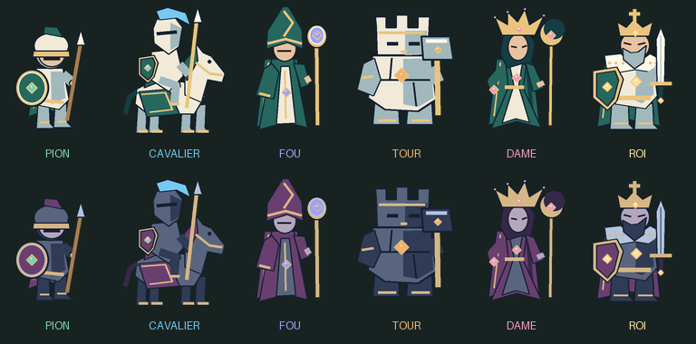
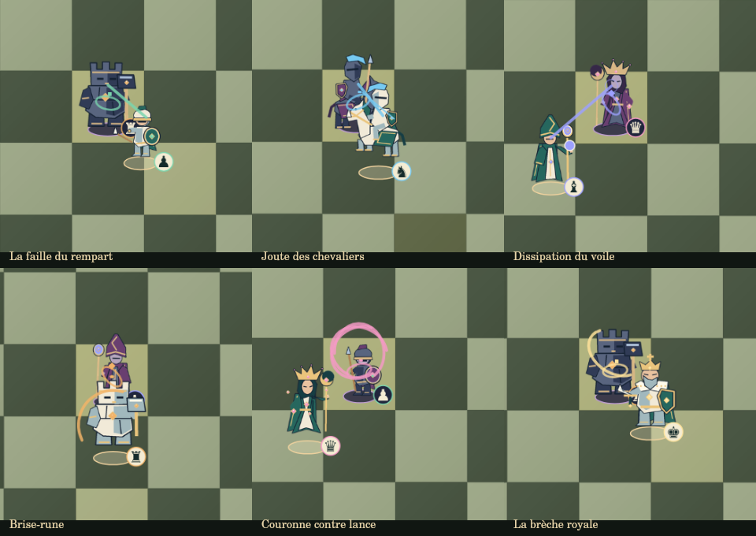

# Grandmaster Chess — Battle Edition 2D

Jeu d’échecs fantasy en HTML5, CSS3 et JavaScript, avec rendu Canvas 2D, Stockfish WASM et mode 1 contre 1 en ligne sans inscription. Le serveur Node sert le jeu et associe automatiquement deux joueurs ; les modes ordinateur et à deux sur le même appareil fonctionnent aussi en hébergement statique.

## Lancer et jouer en ligne

Avec Node 20+ (aucune installation de dépendances nécessaire pour lancer le jeu livré) :

```sh
npm start
```

Ouvrir `http://localhost:8080`, puis cliquer **En ligne**. Le premier joueur attend ; dès qu’un second clique **En ligne** sur le même serveur, la partie commence. Les couleurs sont attribuées au hasard. Aucun compte, salon ou code à saisir. Pour essayer seul, utiliser deux onglets indépendants ouverts directement sur le site, ou deux navigateurs.

Les coups sont validés par le serveur et envoyés aux deux joueurs par Server-Sent Events (SSE). Les horloges de 10 minutes sont communes, démarrent après le premier coup et continuent pendant les animations en ligne. L’analyse, l’annulation et le chargement de positions sont désactivés pendant une partie en ligne. L’export PGN reste disponible.

Un rechargement du même onglet reprend automatiquement la session. Après une déconnexion, le joueur dispose de 30 secondes pour revenir avant de perdre par abandon (le temps de jeu continue). Quitter le mode en ligne ou relancer une recherche abandonne la partie en cours. Les sessions déconnectées sont conservées cinq minutes, puis supprimées.

### Héberger le mode en ligne

Exécuter `npm start` sur **une seule instance Node persistante**, accessible aux deux joueurs. `PORT` (8080 par défaut) et `HOST` (`0.0.0.0` par défaut) sont configurables. En production, utiliser HTTPS devant le serveur. Si un reverse proxy est utilisé, acheminer `/api/*` vers Node, autoriser les connexions SSE longues et désactiver leur buffering ; le serveur envoie `X-Accel-Buffering: no` et `Cache-Control: no-cache, no-transform`.

La file d’attente et les parties sont en mémoire : un redémarrage les efface. Cette version convient à un petit serveur partagé ; plusieurs instances nécessiteraient un stockage et une file communs. Un hébergement statique seul (comme GitHub Pages) ne fournit pas le mode en ligne.

### Jouer uniquement hors ligne réseau (ordinateur / même appareil)

Servir `dist/` par HTTP (les modules et le Worker ne fonctionnent pas via `file://`) :

```sh
python -m http.server 8080 --bind 127.0.0.1 --directory dist
```

Ouvrir `http://127.0.0.1:8080`. La distribution contient déjà les dépendances du jeu.

## Six silhouettes reconnaissables



| Pièce | Personnage et silhouette | Attaque |
| --- | --- | --- |
| Pion | Petit lancier, casque rond et bouclier circulaire | Estoc à la lance |
| Cavalier | Cheval bardé, cavalier et longue lance | Charge et cabré |
| Fou | Robe longue, mitre fendue et bâton lumineux | Rayon arcanique |
| Tour | Large golem de pierre, créneaux et marteau | Frappe et onde de choc |
| Dame | Couronne à cinq pointes, robe et sceptre en croissant | Vortex et gemmes en orbite |
| Roi | Couronne à croix, manteau, grand bouclier et épée | Taille royale |

Les douze spritesheets transparentes sont originales et reproductibles avec Pillow. Chaque feuille comprend huit états de huit frames : repos, déplacement, attaque, réaction, défaite, victoire, transformation et garde. Les deux camps conservent des palettes différentes, des socles distincts et un symbole d’échecs contrasté, désactivable dans les paramètres. La légende sous le plateau, l’inspection au survol/toucher/clavier, les promotions et la galerie utilisent les noms classiques des pièces.

## Trente rencontres de capture

Chaque couple **attaquant → défenseur** dispose d’une rencontre nommée, d’une feinte, d’un angle de contact, d’un recul et d’un profil sonore distincts. Les six styles d’attaque s’associent aux défenses des cinq types capturables : bouclier du pion, monture cabrée, sceau du fou, rempart de la tour et voile de la dame. Le roi ne se capture jamais.



Le mouvement passe par l’approche, l’anticipation défensive, l’attaque et le retour sur la case légale. L’événement `impact` de la frame 4 déclenche exactement une fois la réaction, les particules et le son. Les timbres synthétisés combinent la classe de l’attaquant et celle du défenseur ; le son se réactive avec ♫. Les personnages font face à leur adversaire, y compris sur un plateau retourné. La prise en passant vise le pion sur sa vraie case avant de rejoindre la destination légale.

**Choisir un duel** permet d’essayer les 30 combinaisons. Le lancement ouvre une nouvelle position de démonstration en mode à deux. Les réglages proposent les animations complètes, rapides ou désactivées, la vitesse, le volume, les particules et la réduction des effets. Ce dernier mode supprime les sauts, feintes, secousses, particules et boucles de repos, en conservant la chronologie de capture.

## Règles et parties

Sélection au clic/toucher ou au clavier (flèches et Entrée), coups légaux, roque à deux acteurs, prise en passant, quatre promotions, échec et mat, analyse FEN/Stockfish, export PGN, sauvegarde/reprise locale, parties à deux et Stockfish 18 Lite en Worker avec 10 niveaux.

Les deux camps disposent de 10 minutes. Les horloges démarrent après le premier coup, sont suspendues pendant les animations et continuent pendant la réflexion de Stockfish. Une nouvelle partie, une annulation ou un chargement invalide la génération précédente et termine le Worker. La position légale est mise à jour une seule fois avant l’animation ; le rendu conserve un instantané antérieur et rejoint l’état courant à la fin ou au passage. Les combats n’utilisent aucun calcul de dégâts et ne modifient jamais les règles.

## Construire et vérifier

- `npm test` (Node 20+) : 27 tests, sans installation préalable, utilisant les bibliothèques livrées dans `dist/vendor/`.
- `npm install` puis `npm run build` : copie chess.js 1.4.0 et Stockfish 18.0.5 dans la distribution. Cette étape n’est nécessaire que pour reconstruire les fichiers vendor.
- `python scripts/create-sprites.py` avec Pillow 10.1+ : régénère les douze PNG, l’atlas et la planche de personnages.
- `python scripts/package-source.py` : met à jour l’archive source téléchargeable, sans inclure `.git`, les dépendances locales ni l’archive elle-même.

Les tests réseau vérifient le matching automatique, la séparation des camps, les coups illégaux ou dupliqués, la synchronisation, la reconnexion, l’annulation de recherche, l’abandon et les horloges serveur. Ils ouvrent temporairement un port HTTP local.

Les tests couvrent aussi les 30 captures de classes différentes, les signatures de mouvement et de son, l’impact à différentes durées de frame, la conservation de la position légale, l’annulation et le passage, les quatre promotions, le roque, la prise en passant dans les deux orientations, les réglages de réduction des effets, les horloges, la sauvegarde, les réponses tardives et le véritable moteur WASM.

Contrôle visuel du Canvas effectué à 900 et 360 pixels, ainsi que sur six rencontres représentatives. Les images de prévisualisation proviennent du moteur de rendu du jeu. Le parcours en ligne a été vérifié dans deux sessions Chromium distinctes, avec des fenêtres de 1280 et 390 pixels : matching, coup synchronisé, reprise après rechargement et abandon, sans erreur JavaScript. Les appareils mobiles physiques et l’écoute des effets sonores n’ont pas été vérifiés.

Les personnages restent des illustrations vectorielles stylisées rasterisées ; une production artistique fantasy HD et des bruitages enregistrés constitueraient une finition supplémentaire.

## Licences

Projet publié sous GPL-3.0, voir LICENSE. chess.js 1.4.0 : BSD-2-Clause, texte dans dist/vendor/chess-LICENSE.txt. Stockfish.js 18.0.5 / Stockfish 18 Lite : GPLv3, copyright Chess.com LLC et contributeurs Stockfish. Binaire single-thread non modifié, renommé stockfish.js/stockfish.wasm. Source et instructions de compilation : https://github.com/nmrugg/stockfish.js/tree/v18.0.0 ; distribution npm : https://www.npmjs.com/package/stockfish/v/18.0.5. Une archive du source upstream accompagne la distribution. Les polices Google Cormorant Garamond et DM Sans sont facultatives, avec repli Georgia/Arial ; leur absence ne bloque pas le jeu.
